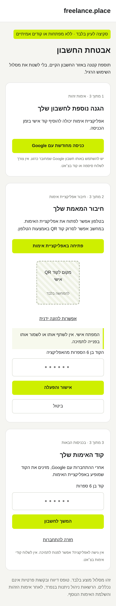

# MFA setup proposal — awaiting owner approval

[Open mobile preview](mobile.png)

This is a standalone mockup, not an application route. QR and code fields are placeholders. On mobile, opening an authenticator directly or entering a key manually avoids requiring users to scan their own screen. Actual keys/codes must remain in the authenticated browser and authenticator, never chat, screenshots, logs or an external image service.

The owner must sign in with the intended Google identity before moderator onboarding. No moderator role has been assigned, no project-wide mandatory MFA imposed, and no Google secret changed. Report and privacy-request flows remain on hold. Implementation requires approval of this proposed UX, optional TOTP backend configuration, enrollment, and a tested MFA sign-in challenge before granting moderator authority.
