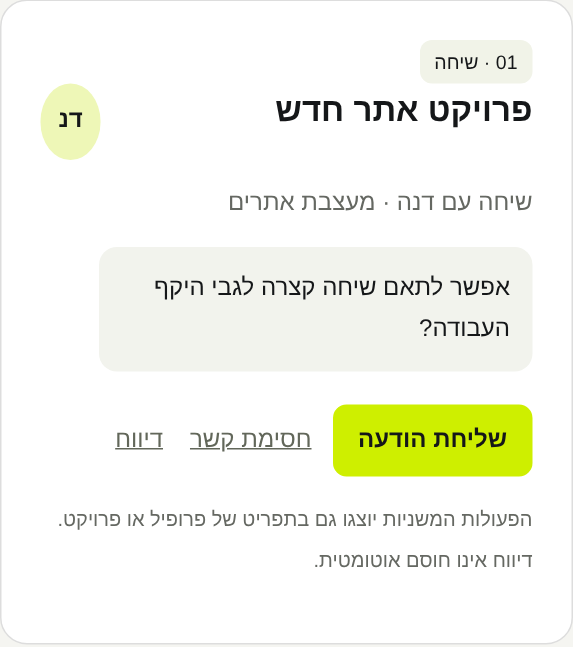
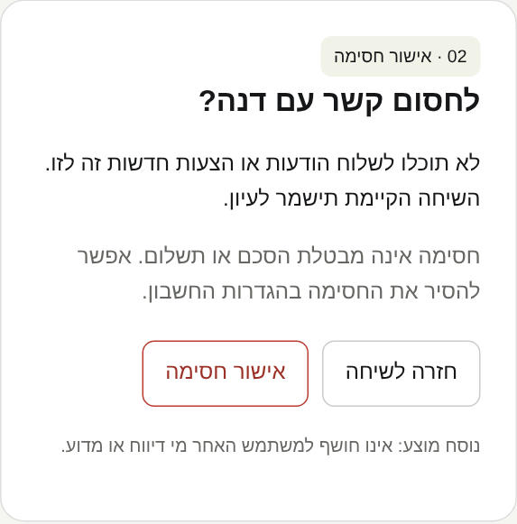
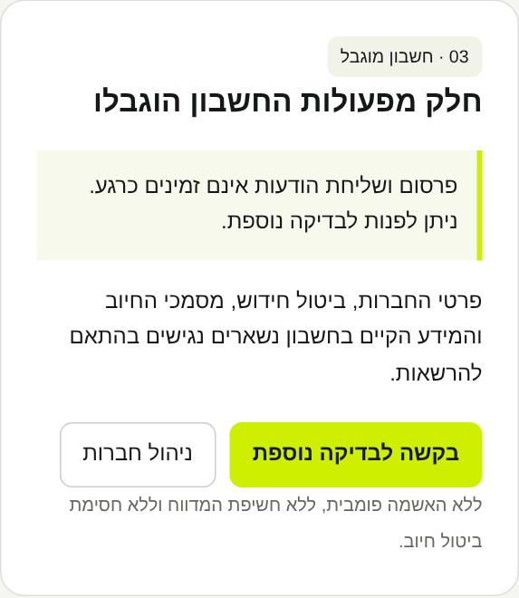
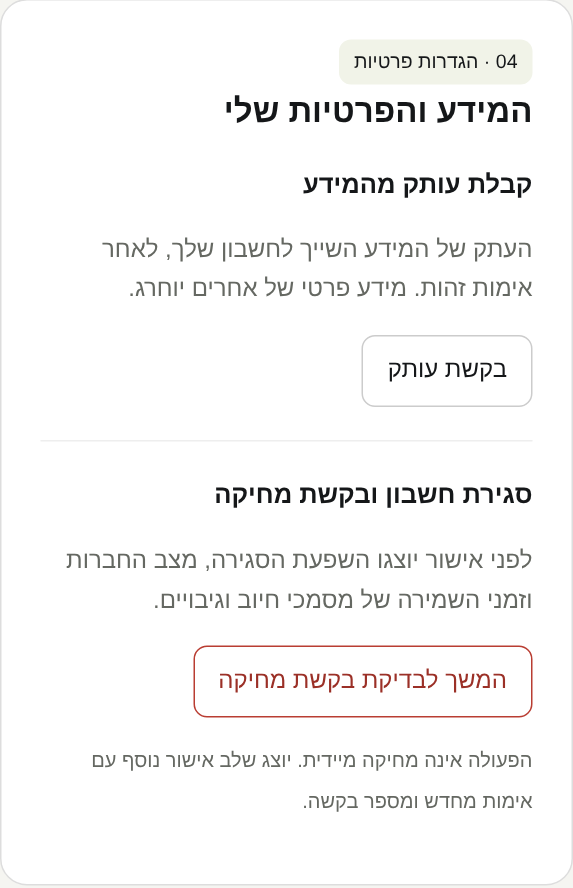
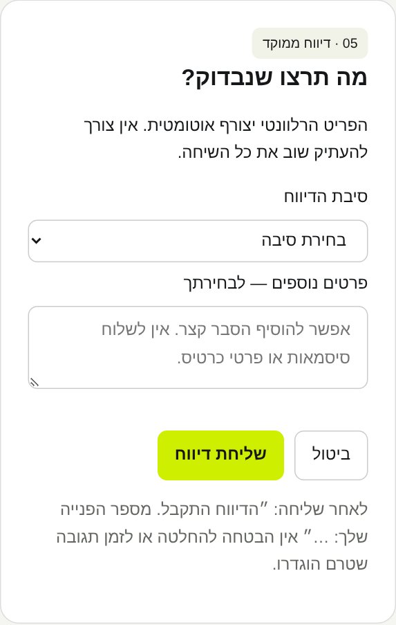

# Safety and privacy UX proposal

Open [index.html](index.html) in a browser. This standalone Hebrew RTL prototype covers secondary report/block actions, block confirmation, restricted-account access, privacy requests and a focused report form. It uses the existing light surfaces, ink and chartreuse palette; it does not modify application components.

Only the sample dialog open/close controls are interactive. Other buttons are examples and submit nothing. Product implementation and moderator/privacy APIs await approval of the flows. Review wording, placement, impact on the normal journey, block semantics and the deletion confirmation before approval.

## Mobile previews

These screenshots were rendered at a 430px mobile viewport. Tap an image to enlarge it. They are proposals only; application screens remain unchanged.

### Conversation actions

### Block confirmation

### Restricted account

### Privacy requests

### Report form

[Full mobile preview](mobile-preview.png)

Screenshots were rendered with Playwright from the standalone HTML. Direct file navigation was blocked by browser policy; rendering the HTML content directly succeeded.
