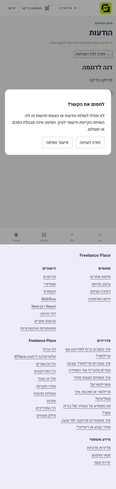
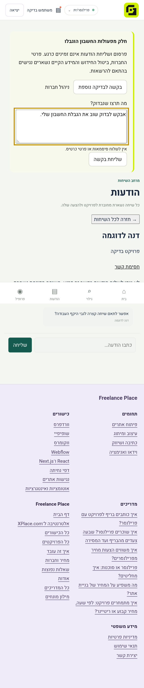

# Implemented safety flows — mobile review

These are captures of the built application at a 430px viewport using synthetic test accounts and intercepted test APIs. No real account data is shown. The owner approved blocking/unblocking and restriction/appeal flows; reporting and privacy-request forms remain deferred.

## Block confirmation

## Restricted account and appeal

Application/backend checks cover repeated sends after unblocking, two-way contact restrictions, protected historical reads, appeals and moderator authorization. Production deployment and designated-user acceptance remain separate rollout steps.
